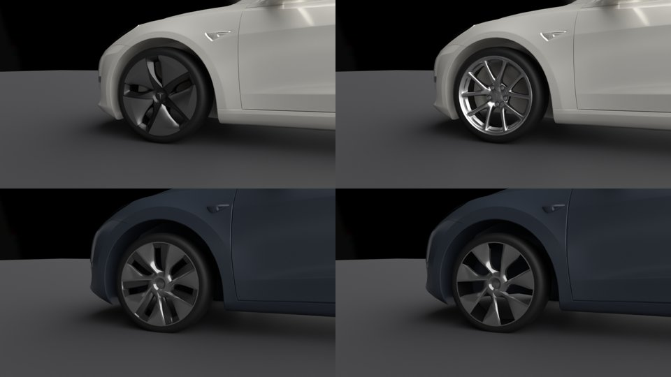

# Showroom stage

`Powerwall-TV/ShowroomStage.swift` rebuilds the stage the Tesla app puts a car on.
The values come from the Tesla Android app 4.62.5 asset pack, decompiled with GDRE Tools.


The before and after columns are Cycles approximations of the SceneKit scene, made with
`tools/render.py`. They are not simulator captures. The reference is
`assets/img/car_wrap_arcade_placeholder.png` from the app.

## What the Tesla app does

| Part | Tesla source | Value | SceneKit |
| --- | --- | --- | --- |
| Background | `EnvironmentManager.gd` `dark_background_color` | `#161718` | `scene.background`, view background |
| Lighting | `mobile.tscn`, `env/mobile.tres` | No lights. PanoramaSky `New_Studio.png` | `scene.lightingEnvironment` = `ShowroomStudio.png` |
| Sky rotation | `MobileEnvTest.gd`, `Snapshots.gd` PARKED | `(0, -11, 83)`° | Baked into `ShowroomStudio.png` by `tools/bake_env.py` |
| Sky energy | `Snapshots.gd` PARKED | background 6, ambient 2.6 | intensity 2.2, because our paint is lifted to display colours |
| Camera | `Snapshots.gd` PARKED | rotation `(-25, -138, 0)`°, `(-4.13, 3.09, -4.73)`, FOV 30° | `CarShowroomOrbit.restingOffset`, FOV 30° |
| Floor | `reflective_floor.tres`, `.shader` | unshaded, background colour, mirror at 10%, half resolution | `SCNFloor` reflectivity 0.1, `reflectionResolutionScaleFactor` 0.5 |
| Floor fade | `reflective_floor.shader` | `1 - smoothstep(5, 15, distance)` m | fragment shader modifier on alpha |
| Glow | `ReflectiveFloor.gd` `update_glow_plane` | 8.2 × 4.3 m half size, 16.3 m behind `(0, 1, 0)`, faces camera | `ShowroomStage.glowPlacement` |
| Glow colour | `Terrain.gd` `ColorToHighlightMap`, `calculate_highlight_for_paint_color` | paint table, else value × 0.325 × 5, max 0.7 | `ShowroomStage.highlight` |
| Glow opacity | `Terrain.tscn` `night_mode_highlight_fade` | 0.26, gone when looking down 37°–58° | material transparency |
| Contact shadow | each car's `Floor` quad and `Ground_AO*.png` | baked AO | `*_GroundAO.png` on a quad |

## Assets

- `ShowroomStudio.png`: `New_Studio.png` with the sky rotation baked in, 1024 × 512.
- `*_GroundAO.png`: each car's `Ground_AO` texture, rotated so the top is the nose (−Z) and the left is −X.
  Model Y Juniper uses Highland's, because its exported texture is empty. Generic uses Model 3's.
- `Wheel_*.usdz`: the Tesla app's 71 wheel scenes, one usdz each (8.8 MB together). See [Wheels](#wheels).
- The car usdz files carry no wheels, only four `WheelAnchor_*` empties.

These are Tesla's copyrighted assets. Keep them in this private repository.

## Tuning

- `ShowroomStage.environmentIntensity` sets how bright the studio reflections are.
- If the studio reflections look mirrored left to right, flip `ShowroomStudio.png` horizontally.
  SceneKit's equirectangular convention was not checked on a device.

## Lamps


In the Tesla app the car is parked with its lamps off, so nothing glows. The lamps look right
because of the lamp housing material. Lights_BC is a texture atlas of chrome reflectors,
projector bowls, LED strips, and red and amber lenses. Lights_MRA packs metallic, roughness, and
occlusion. A thin smoked lens (Glass_Lights) sits over the housing. The mobile environment
(`env/mobile.tres`) has no glow or bloom. No vehicle scene contains an OmniLight or a SpotLight,
and there is no welcome animation.

| Car | Housing (`Light`/`Lights`) albedo × BC, metallic × R, roughness × G, AO = B | Lens (`Glass_Lights`) colour, alpha, roughness |
| --- | --- | --- |
| Model 3 | 0.102, 0.7, 0.0 (mirror) | 0.0118, 0.51, 0.05 |
| Model 3 Highland | 0.137, 1.0, 1.0 | 0.0118, 0.39, 0.05 |
| Model Y | 0.102, 0.7, 0.5 | 0.0118, 0.39, 0.05 |
| Model Y Juniper | `Light_Off` flat 0.0196, roughness 0.45 | 0.0118, 0.39, 0.05 |
| Model S | 0.098, 0.75, 0.5 | 0.0118, 0.43, 0.1 |
| Model X | 0.098, 1.0, 1.0 | 0.0118, 0.51, 0.1 |
| Cybertruck | `Lights1` 0.349, 0, 1.0 | 0, 0.51, 0.01 |

The glowing "lights on" meshes are separate. `Headlights`, `DRL`, `Brake_Lights_*`,
`Reverse_Light`, and the turn signals use `Illumination`, which is additive, unshaded black,
and shows the `Lights_E.png` emission map at energy 0.65–0.8. The `*_Projections` meshes add the
light pools on the ground. All of them are hidden by default. `Vehicle.gd` shows the headlights
only while the car is driving (`set_headlights_on(data.isDriving())`). The Godot glTF export
skips hidden nodes, so these meshes are not in our models.

`tools/build_vehicles_v2.py` now writes the lamp housing as `Lamps`, with `primvars:st`, and the
lens as `LampGlass`. It skips the `*_Global` lamp meshes, which use a different atlas. Before this
change both went into one flat red `Lights` mesh, which `VehicleLights` split into three glowing
lenses. `VehicleLamps` in `HouseLighting.swift` puts `<Model>_Lamps_BC.png` and
`<Model>_Lamps_MRA.png` on the housing, using `textureComponents` red, green, and blue, and makes
the lens the smoked glass.

### Translucent lenses

Copied as is, these values turned every lamp black in SceneKit. There were two causes:

- **Housing too dark.** The app multiplies the atlas by about 0.1 and relies on its studio
  reflections for the chrome. SceneKit has no environment in the home and garage views, and only
  a weaker one in the showroom. A metallic surface with a 0.1 albedo then renders almost black.
- **Smoke drawn twice.** The lens was double-sided with `.dualLayer`, so its back faces and its
  front faces each laid down the 39–51% smoke. Glass_Lights culls back faces, so the app draws it
  once.

The conversion didn't lose any transparency: the usdz lens still has opacity 0.39 to 0.51, and the
housing never had opacity.

What changed in `VehicleLamps`:

- The housing shows the atlas at `displayAlbedo` (0.75). The chrome reflectors, projector bowls,
  LED strips, and the red and amber lenses now show through the glass. Black stays only where
  Tesla's atlas is black, such as lamp trim and bezels.
- The lens keeps Tesla's colour, alpha and roughness, but it's single-sided (`cullMode = .back`,
  `.aOne`), so it reads as lightly smoked glass.
- `ShowroomStage.makeMirror` gives the reflected car its own lens copy that culls front faces,
  because the flip turns the faces inside out. The car's own lens stays single-sided.
- Emission stays black, so the lamps stay off when the car is parked.

The same `VehicleLamps.dress` runs in the showroom (`CarShowroom.loadVehicle`) and in the home and
garage views (`HouseLighting.setVehicleModel`).

Some black parts are separate meshes, not areas of the atlas:

- The charge port (`Chargeport_1`, Chargeport.material) is exported as `Trim` and stays black.
- Fog lamp covers are also `Trim`.

Model Y Juniper is still dark. Its lamps use the flat `Light_Off` black (0.0196) in the app too.
Its red `Reflector` parts were most likely exported as `Trim`, and the raw glTFs needed to split
them out again are no longer on the box.

### Still black in SceneKit (81f5022)

The Cycles previews looked right, but the iOS Simulator and macOS still drew the lamps black. On
Linux, the usdz shows the likely reason. The `Lamps` mesh has `primvars:st`, but its material is a
flat `UsdPreviewSurface` (diffuse 0.1, metallic 0.7) with no `UsdPrimvarReader_float2` or
`UsdUVTexture`. Every texture in `ResidentialClassic.usdz`, which does show in SceneKit, is wired
through that reader-texture chain. If SceneKit's import drops the unreferenced UVs, the atlas has
nothing to map onto. Then, with metalness from the packed map, an occlusion map, and no lighting
environment in the home and garage views, the housing renders black. Blender reads `st`
regardless, so it hid this.

The fix covers each link in that chain:

- `tools/embed_lamp_textures.py` packages `0/<Car>_Lamps_BC.png` inside each textured car's usdz
  and wires it into the `Lamps` material: a reader for `st`, a texture into `diffuseColor`,
  metallic 0 and roughness 0.35. The import now has a reason to keep the UVs, and even without
  the app's dressing the housing isn't a dark metal.
- `VehicleLamps` builds a housing that can't go black:
  - metalness 0, no occlusion map, opaque, with depth writes;
  - the atlas on `diffuse` at 0.75, plus the same atlas on `emission` at `emissionFloor` (0.12);
  - a mid-grey fallback (`fallbackGrey`) if the atlas or the texture coordinates are missing.
- The lens sets `transparent` and `multiply` to white and `transparency` explicitly (`.aOne`),
  with depth writes off.
- Lamp materials match by material name, prim path or numbered copy, with the mesh name as a
  fallback (`VehicleLamps.role`).
- The showroom has a `lightingEnvironment` (`ShowroomStudio.png`). The home and garage views
  don't, which is why the housing no longer uses metal.

To check on a device, launch with the argument `-debugLamps YES`, or set
`POWERWALL_DEBUG_LAMPS=1` in the scheme. The console then lists each matched lamp material, for
example:

```
[Lamps] ModelY: 2 lamp material(s) matched
[Lamps] ModelY: housing node=Lamps material=Lamps texcoords=true atlas from bundle ModelY_Lamps_BC.png
[Lamps] ModelY: lens node=LampGlass material=LampGlass hidden=false order=5 tint=0.0 (Tesla opacity 0.39) | model=blinn mode=0 blend=0 transparent=NSColor(alpha 1.0) transparency=0.12 doubleSided=false ...
```

`texcoords=false` or `nothing named Lamps or LampGlass` points straight at the import.

### Brightness (bb2f130)

Simon's `-debugLamps` log came back healthy for that commit: the housing matched,
`texcoords=true`, and the atlas loaded from the bundle. So what was left was brightness. Three
things kept the lamps dark:

- **The lens.** It still had Tesla's near-black tint (0.0118) at 0.39 to 0.51 opacity, so it
  covered the housing in black smoke.
- **The housing colour.** It was at 0.75.
- **The glow floor.** At 0.12, it was faint.

The atlas PNGs have no colour profile. SceneKit reads them as sRGB, the same as Godot does, so no
colour-space fix was needed.

The showroom lights the housing through its `lightingEnvironment` (`ShowroomStudio.png`, 2.2).
The home and garage views use the car studio rig (`HouseCarLighting`).

Tuning knobs, all in `VehicleLamps` (`HouseLighting.swift`):

| Knob | Value | Effect |
| --- | --- | --- |
| `displayAlbedo` | 0.8 | Housing atlas brightness (1.0 was a touch bright). Chrome and LED strips are light grey; black stays black. |
| `emissionFloor` | 0.1 | The atlas glows this much, so it reads under any lighting. Black areas stay black. Higher flattens the shading. |
| `housingRoughness` | 0.35 | Housing gloss (lower is glossier) |
| `lensTint` | 0.0 | Lens colour, from 0 (black) to 1 (white), blended in at `lensOpacity`. Grey veils the housing. |
| `lensOpacity` | 0.12 | Lens opacity. Tesla's is 0.39 to 0.51. |
| `lensSpecular` / `lensShininess` | 1.0 / 1.0 | Lens glints from the lights (Blinn) |
| `lensRenderingOrder` | 5 | Lens nodes draw after the car (0 in the showroom, 2 at home) and before rain and snow (7) |
| `fallbackGrey` | 0.35 | Housing colour if the atlas or the UVs are missing |

`-debugLamps YES` now also prints the albedo, emission, lens tint and opacity in use.

### Grey, not see-through (b1075b1)

With `lensTint` 0.6 the lamps read as flat grey. The SceneKit docs confirm the blending:

- a pixel's opacity is the colour of `transparent` (under `.aOne`, its alpha) multiplied by
  `transparency`;
- the lens's white `transparent` with `transparency` 0.2 was therefore already 80% see-through.

Three things made it look grey anyway:

- **The tint.** A light grey lens blends a grey veil over everything.
- **Fresnel.** Physically based shading adds a reflection of the grey studio on top. It grows
  toward 100% at glancing angles, which is how the curved lenses are seen.
- **The glow.** The housing's 0.3 emission flattened its shading.

The changes:

- The lens is now Blinn, which has no environment reflection: a black body at 12% opacity plus
  specular glints from the lights. It draws after the car (`lensRenderingOrder`).
- The housing glow is down to 0.2.

`-debugLamps hideLens` (or `POWERWALL_DEBUG_LAMPS=hideLens`) hides every lens, so the housing alone
shows. The log prints each lamp material's lighting model, transparency mode, blend mode,
`transparent` contents and alpha, `transparency`, whether it's double-sided, whether it writes
depth, the type of its diffuse contents, and its emission.

`build_vehicles_v2.py` now writes the lens single-sided for future exports. The shipped usdz files
are unchanged, because the app sets this on the material.

`tools/headlights.py` makes the close-ups. Run it with `LAMPS=before|after|glass`, `USDZ=`, and
`VIEW=front|rear`. `glass` is the translucent-lens fix, tuned with `HOUSING_ALBEDO` and
`HOUSING_METAL`. The renders are Cycles approximations, not SceneKit captures.

## Floor reflection

The reflection used to come from `SCNFloor` (reflectivity 0.1, half resolution), with a Metal
fragment shader modifier fading the floor out. It did not show on an older macOS. Now the
reflection is the car again, flipped through the floor (`ShowroomStage.makeMirror`). The copy
shares the car's geometry and materials. A plain `SCNPlane` floor in the background colour covers
it at 90% (`reflection_strength` 0.1). The floor's alpha comes from a generated texture
(`floorImage`) and fades out between 5 m and 15 m, like `reflective_floor.shader`. Nothing depends
on SCNFloor reflections, reflection bit masks, or shader modifiers. The draw order is glow (−20),
mirror (−15), floor (−10), contact shadow (−5), then the car.

## Home view: house ground shadow and garage car lighting

**House ground shadow.** The house scene ships a `Shadow` card. Tesla draws it with
`CompactShadow.shader` (Classic: `strength` 2, `exponent` 1), so the alpha is `pow(1 − G, 1) × 2`
and the colour is black. The card used to be hidden. It is now back, with the same black-plus-alpha
approach the showroom floor shadow uses (`HouseGroundShadow` in `HouseLighting.swift`).
`docs/showroom/tools/bake_house_shadow.py` bakes `TeslaAssets/Home_GroundShadow.png` (512², black,
alpha × 2) from the usdz `0/Shadow.png`. The card uses constant lighting and alpha blending and
doesn't write depth. It sits 3 mm above the ground plate, with draw order 1. That puts it after the
sky wash (0) and before the house (2). If the PNG is missing, the card stays hidden.
`GarageVehicleShadow` stays hidden: its texture doesn't match Tesla's `VehicleGarage.png`.
To make the shadow stronger or weaker, change `STRENGTH` in the bake script and rebake.

**Garage car lighting.** The house shell is unlit (`.constant` plus the Building shader port), but
the car is PBR. Under the house's ambient and sun lights alone, it looked flat. The car now has a
small studio rig of its own (`HouseCarLighting`):

- an ambient fill (`HouseCarFill`);
- an overhead key (`HouseCarKey`);
- a low rim from behind (`HouseCarRim`);
- a weak sun that follows the house sun (`HouseCarSun`).

Every rig light, and every node of the car, uses category bit `1 << 4`. `HouseFill` and
`HouseSun` exclude that bit. So the car gets only the rig, and the windows, solar panels and
Powerwall keep exactly the lighting they had. The house shell is unchanged. `setVehicleModel`
marks a swapped-in car the same way.

No light probe and no `lightingEnvironment` in the home view. cf3d74f lit the car with a radiance
`SCNLight` probe fed the equirectangular `ShowroomStudio.png`. That gave the car paint and the solar
panels black highlights in the home view (the showroom was fine):

- SceneKit applies a probe to every physically based material inside its extents and ignores
  `categoryBitMask`, so the probe reached the solar panels as well as the car.
- With `probeUpdateType = .never`, the probe never gets usable radiance from that image, so
  specular reflections sampled black.
- The car had also lost the house fill, so it was left with only the weak sun.

Plain ambient and directional lights do honour category bits. A test checks that the home view
has no probe.

Tuning knobs (all in `HouseCarLighting`):

| Knob | Value | Meaning |
| --- | --- | --- |
| `dayStrength` | 1.2 | Scale on the whole rig in full daylight |
| `fillLumens` / `keyLumens` / `rimLumens` | 320 / 600 / 300 | Each studio light at `dayStrength` 1. The fill matches the house fill. |
| `keyFrom` / `rimFrom` | (0.15, 1, 0.35) / (−0.5, 0.45, −1) | Model-space directions the key and rim shine from |
| `nightFraction` | 0.4 | Share of the rig left at night (theme 0) |
| `sunFraction` | 0.35 | Car sun as a share of the house sun (`350 + 650 · theme · ambientScale`) |

Cloud cover (`ambientScale`) dims the whole rig, the same way it dims the house.
The 4× display boost on paint (`paintDisplayBoost`) stays. The live Fleet paint albedos are dark,
and the showroom needs the same boost even under its stronger studio light.

**Solar out of the floor mirror.** The ground plate is an `SCNFloor` with
`reflectionCategoryBitMask` set to the reflection bit (`1 << 3`). Solar never had that bit, but the
panels still showed in the mirror on Simon's Mac. Now the materials under `SolarPanels` and
`SolarRoof` (`HouseGroundPlate.discardedFromMirror`) are also copied and given `reflectedFragment`,
the same mirrored-camera discard the gateway and the power-flow ribbons already use. The panels are
dropped from the reflection pass whatever the floor does with the category bits. They look the
same in the main view. The house shell, windows and Powerwall still reflect as before.

## Model Y Juniper glass and B pillars


Juniper's roof (`Fade`), rear glass (`Trunk_Cover`), and rear door and quarter windows
(`Back_*_window`, `Static_Exterior`) use `glass_skybox` ShaderMaterials (`Glass_Windows_Dark`,
`Glass_Top_Fade`). The glTF export writes no material for these, and the converter had mapped
them to opaque Trim. They now map to Glass, like the windscreen and front windows. No other car
has unnamed exterior surfaces. The B pillars sit on the `Interior` mesh, which is dropped: the
outer cover is on its Trim surface and the inner trim on its `Pillar` surface. The converter keeps
the triangles of those two surfaces between the door windows, as a gloss black `Pillar` material.

## Wheels



Each car wears its own wheels, read from `vehicle_config.wheel_type` in the `vehicle_data` calls the app
already makes. No new Fleet call is added (see the backfill below).

### Files

- `tools/export_wheels.py` reads every wheel scene in the Tesla app's Godot pack: `WheelTypeToPathMap` and
  `WheelTypeToCapsOverrideMap` in `VehicleOptions.gd`, minus Cybercab. It uses `tools/rsrc.py` and
  `tools/godot.py` for Godot 3 binary and text resources. It writes one usdz per scene into `TeslaAssets`:
  - 71 files, 8.8 MB together.
  - Each is in the wheel's own frame: axle at the origin, +X forward, +Y up, +Z out of the right side.
  - There is one mesh per material, named `WheelTire*` or `WheelRim*`.
  - Textures are 256 px for rims and 128 px for tyres. Albedo has Tesla's baked occlusion multiplied in.
  - Meshes over 3000 triangles are decimated.
  - Rim colours are boosted ×3.5, like the paint display boost. Tesla's albedos are tuned for its
    reflection-heavy renderer and read near black without it.
- `tools/strip_wheels.py` took the baked `Wheels` mesh and the tyre triangles out of the seven car files,
  and added `WheelAnchor_LF/RF/LR/RR` at the app's `Wheel_*_Spatial` transforms. This took the car files
  from 20.2 MB to 17.2 MB.
  - Stripping was chosen over hiding, so no hidden geometry is copied into the floor mirror.
  - Left anchors are turned 180° about Y, never mirrored, so one wheel file faces out on both sides.
  - Cybertruck keeps the body rubber that shares its `Tires` mesh.
- `tools/wheel_table.py` prints the generated part of `TeslaWheel.swift`.
- `tools/render_wheels.py` is the Blender check (`/workspace/showroom-shots/wheels/`).
- `tools/inventory.py` and `tools/anchors.py` list the scenes and read the anchors.

### Choosing a wheel (`TeslaWheel`, `WheelChoice.resolve`)

`TeslaWheel` is the Tesla app's `WheelType` enum (53 styles). Each style has its usdz, and sometimes a
caps swap. Fleet names come from the app's mobile and gateway tables (83 keys). They are compared as
lowercase letters and digits, so `PINWHEEL_18`, `pinwheel18` and `Pinwheel18` match. A name is matched in
this order:

1. An exact table name. The app's own `…CapKit` names already point at the caps-off style:
   `Pinwheel18CapKit` → `Wheel_Pinwheel_No_Cap`.
2. A name ending in `CapKit`, `NoCaps` or `CapsOff`, with that suffix removed. Caps come off when the style
   has a caps-off file: `Glider18CapKit` → `Wheel_Glider_No_Caps`.
3. The shortest table name that starts with it, then the longest table name it starts with, then a
   marketing name: `Photon` → Glider, `Nova` → Nova19Dark, `Crossflow` → Crossflow19.
4. The model's standard wheel. This covers nil, `""`, `UNKNOWN` and any name the tables do not know.

| Model | Standard wheel |
| --- | --- |
| Model 3 | Pinwheel (`Wheel_Pinwheel`) |
| Model 3 Highland | Glider |
| Model Y | Gemini |
| Model Y Juniper | Helix 2.0 (`Wheel_Helix2`) |
| Model S | Cardenio |
| Model X | Cyberstream |
| Cybertruck | Cybertruck Standard |
| Generic | none: the baked body keeps its own wheels |

A Cybertruck only takes Cybertruck wheels, and no other car takes them. Catalogue cars always wear the
standard wheel. Caps default to on, as in the Tesla app. Fleet does not send the app's `wheel_caps_on`, so
caps come off only when the name says so. The `capsOn:` argument is there for when it does.

### Mounting (`VehicleWheels.mount`)

The chosen usdz is loaded once per look and cloned onto each `WheelAnchor_*`. It is dropped so the tyre
bottom sits 5 mm into the floor, using the radius from its bounding box and the anchor's height and
scale. A 20" wheel on an 18" hub therefore neither floats nor sinks. Mounted nodes are named
`VehicleWheel_<usdz>`.

- **Showroom** (`CarShowroom.scene`): this uses Tesla's metal and roughness under the studio panorama.
  Wheels are mounted before `ShowroomStage.makeMirror`, so the floor mirror clones them.
  - `CarShowroom.repainted` re-reads the saved `wheel_type` even when the paint is not known.
  - A reply that lands while the showroom is open changes `displayed` and rebuilds the stage with the new
    wheels.
- **Home garage** (`HouseLighting.setVehicleWheels`):
  - `setVehicleModel` mounts the standard wheel first.
  - `HouseSceneView.apply` swaps in the car's own wheel when `GaragePresentation.wheelType` resolves to a
    different usdz.
  - The home has no environment for metal to reflect, so its wheels use metalness 0.
  - Wheels get `HouseCarLighting.mark`, so they are lit only by the car's lights, and they are left out of
    the ground plate's reflection.
- **Demo** uses a real Fleet name per model, with no Fleet call. Model 3 uses `Pinwheel18CapKit`, so demo
  shows caps off. The others use `Nova19Dark`, `Induction20Black`, `Crossflow19`,
  `Tempest19SonicSilver`, `Turbine22Dark` and `CTPremium20`.

### Saved per VIN, and the one backfill

`VehicleAppearance.wheelType` is saved with the paint in `fleetVehicleAppearanceCache`. It has three
states:

- a name, such as `"Gemini19"`;
- `""`: a `vehicle_config` was read and had no `wheel_type`;
- nil: no `vehicle_config` has been read since wheels were added.

A merge keeps a named wheel over a later `""`.

`fetchVehiclePaintIfNeeded` used to stop once the paint was known. It now stops once the paint is known
and `wheelType` is not nil. A car saved by an earlier build is therefore asked once more, while it is on
stage in the showroom:

- It uses the same `vehicle_data?endpoints=vehicle_config` call and the same `VehiclePaintFetchPolicy`
  backoff.
- It never calls `wake_up`: an asleep car answers 408 and is asked again after 30 minutes.
- The reply is saved even when it has no `wheel_type`, so the car is never asked again.

A plugged-in car's charge call and `vehicle_data_cached` (when it carries `vehicle_config`) fill the field
too. Clear All Settings clears it with the rest of the appearance cache. Demo makes no call.

`-debugPaint YES` adds the following:

- the raw `wheel_type` on every paint and charge call;
- the saved `wheel_type` on each car's line;
- a `wheels wheel_type=… → Style caps on|off Wheel_….usdz (fleet|standard)` part on each car's line.

VINs are cut to their last 4.

## Garage lineup: the account's cars, then the catalogue

A garage tap (the garage door, the parked car, the charging readout, or the tvOS car button) first
asks Fleet `GET /api/1/products` which cars are on the account, then opens one lineup:

1. The car parked in the garage, when the house is showing one.
2. The other cars on the account, in the order Fleet lists them. Each uses its own mesh (from
   `vehicle_config.car_type` when the app already has it, otherwise the VIN), its last known paint and
   charge lines, and the vehicle info panel. These have no buy link.
3. Every catalogue model, each with its Buy a Tesla link and no info panel.

The arrows step through the whole lineup and wrap. An account with no cars gets the catalogue alone,
so it looks the same as before. Every car arrives in its own paint and glow: a colour tried with up and
down is dropped when the arrows move on, so it never carries to the next car.

### Paint for each car (`ShowroomPaint`, `CarShowroom.paintSource`)

An owned car's paint comes from the first of these that knows it:

1. `vehicle_config` (`exterior_color`, `paint_color_override`, `car_type`), saved per VIN in
   `UserDefaults` (`fleetVehicleAppearanceCache`), so the next open draws the right colour before any
   call. A field missing from a newer reply keeps the saved value. It comes from either:
   - the live charge call for a plugged-in car (`vehicle_data?endpoints=charge_state;vehicle_config;vehicle_state`), or
   - the showroom paint call below, for any account car on stage whose paint is not known.
2. Products `color`, when Tesla fills it in (usually null). It can be a name or a paint code.
3. Nothing known: the Tesla app's neutral fallback grey with a grey glow, and no colour in the title.

Fleet sources that are never used for paint:

- `vehicle_data_cached`. Tesla documents that it only has `charge_state`, `climate_state`,
  `gui_settings` and `vehicle_state`, never `vehicle_config`. The app still reads `vehicle_config` if it
  ever appears.
- `option_codes` on products and `/vehicles`. Tesla stopped filling it in: it is null, or the same generic
  Model 3 list for every car. Using it would give every car the same wrong colour.
- The car file's own colour. Highland's is blue and Model Y's is Pearl White, so an unknown car used to
  look like a real but wrong paint. Catalogue cars, Generic and a stainless Cybertruck still use it.

#### The showroom paint call (`fetchVehiclePaintIfNeeded`, `VehiclePaintFetchPolicy`)

While an account car with no known paint is on stage, the showroom asks
`GET /api/1/vehicles/{vin}/vehicle_data?endpoints=vehicle_config`. A 400 retries once without the filter.

- It never calls `wake_up`. An asleep or offline car answers 408 and is asked again after 30 minutes, only
  if it is on stage again.
- Failures wait 15 minutes. A 403, or a reply with no paint, waits a day. A 429 waits for `Retry-After`,
  and never less than 15 minutes.
- Once the paint is saved it is never asked again for that VIN. In practice that is one call per car, ever,
  at Tesla's $0.002 per call.
- The reply repaints the car on stage and its glow at once. The home garage reads the same per-VIN store,
  so the parked car picks up the paint too.
- Demo, local logins and catalogue cars never call.

#### Paint diagnostics: `-debugPaint YES`

Add `-debugPaint YES` to the scheme's launch arguments (or set `POWERWALL_DEBUG_PAINT=1`). The console then
prints `Paint:` lines with VINs cut to their last 4 and no car names:

- for each car from products: raw `color` and `option_codes`;
- for each paint call or plugged-in charge call: the status, whether `vehicle_config` was present, and the
  raw `exterior_color`, `paint_color_override` and `car_type`;
- for `vehicle_data_cached`: whether `vehicle_config` was present;
- for each car shown: the model, products `color` and `option_codes`, the saved `vehicle_config` fields,
  the source used, the resolved paint and display hex, and the glow hex.

How a known paint is drawn:

| Case | Showroom paint | Glow |
| --- | --- | --- |
| Paint name the table knows | `TeslaPaint.display`: the readable colour the demo uses, at boost 1 | The floor's table colour for that paint |
| Override with no known name | The override at the live boost (4) | The app's formula on the override |
| Account car with no known paint | The Tesla app's fallback grey at the live boost | A soft grey |
| Generic, stainless Cybertruck, catalogue car | The file colour | The file colour's table entry |

A known name wins over `paint_color_override` in the showroom. The Tesla app's albedos are meant for its
reflection-heavy renderer: Pearl White is `0x181818`, which reads as mid grey once lifted, so the display
colour is what makes a white car look white. The home garage still uses the app's order (override, name,
fallback) and is unchanged.

Names match without regard to case, spaces or punctuation, and accept marketing spellings: "Stealth
Gray", "Pearl White Multi-Coat", "Deep Blue Metallic", "Obsidian Black" and so on. Paint codes come from
Tesla's service manual tables. They are only used when products `color` holds a code:

| Code | Paint | Code | Paint | Code | Paint |
| --- | --- | --- | --- | --- | --- |
| PPSW, PM00 | Pearl White | PN00 | Quicksilver | PB00 | Frost Blue |
| PBCW | White | PN01 | Stealth Grey | PB01 | Glacier Blue |
| PMNG | Midnight Silver | PN02 | Lunar Silver | PB02 | Marine Blue |
| PMSS | Silver Metallic | PR00 | Midnight Cherry Red | PB03 | Coastal Blue |
| PBSB | Solid Black | PR01 | Ultra Red | PX02 | Diamond Black |
| PMBL | Obsidian Black | PPSB | Deep Blue | PPMR | Red Multi-Coat |
| PPSR | Signature Red | PPTI | Titanium | PMTG, PMSG, PMAB, PMMB | Older greys, green, brown, blue |

Cybertruck stays stainless steel (the file finish) unless a colour step or a wrap override is set. Codes
with no paint in the app's table, such as Cosmic Silver (PN03), count as unknown.

### Last car shown (`ShowroomLastCar`)

The car on stage is saved as `showroom_lastCar` in `UserDefaults`: `vin:<VIN>` for an owned car or
`model:<model>` for a catalogue car, never a lineup index. It is written when the showroom opens and each
time the arrows move. The next open starts on that car if it is still in the lineup. Otherwise it starts
on the usual first car: parked, then the first account car, then the first catalogue model. Demo neither
reads nor writes it, so the tour never replaces a real saved car. Settings → Reset clears it, along with
the per-VIN paint store.

| Case | What opens |
| --- | --- |
| Products lists cars | Those cars (the parked one first), then the catalogue |
| Products lists no cars | The catalogue |
| Products fails, times out, 401/403, or no token | Whatever cars are already known, otherwise the catalogue |
| Local gateway login | Cars already known (usually none), then the catalogue. No Fleet call |
| Demo | The demo car with the sample lines, then the catalogue. No Fleet call |

### The products check (`checkConnectedVehicles`, `ConnectedVehicleCheck`)

- It only runs on a tap. Nothing polls. Products lists the account's cars without contacting them, so it
  never wakes a car, and the check never calls `vehicle_data` or `wake_up`.
- An answer is reused for 10 minutes (`ConnectedVehicleCheck.maxAge`, memory only). Taps during a request
  share it. A failure is not cached, so the next tap tries again.
- The request times out after 4 seconds (`ConnectedVehicleCheck.timeout`). The garage opens with what is
  known half a second after that even if products has not answered, so a tap never hangs. While it waits,
  the bottom Loading… line shows and other taps are ignored.
- A failure never sets the home screen's error message. A 401 runs the existing token refresh.
- Cars found are merged into the same `vehicles` list the rest of the app uses. The vehicle chips still
  follow Settings → Show vehicles. Resetting settings (`clearVehicleChargeCache`) forgets the last answer.
- Fleet's products entries for cars carry a VIN and usually no `device_type`. Energy sites carry
  `energy_site_id`. `Product.fleetVehicle` takes an entry with `device_type` `vehicle`, or with a VIN and no
  `energy_site_id`. Duplicate VINs are dropped.
- Stepping to an owned car in the lineup can make that car's throttled `vehicle_data_cached` call (see
  below). The catalogue cars never call.
- Cost: at most one products call per 10 minutes, and only after a tap. At $0.002 per call, that is a
  fraction of a cent a day.

### OAuth scopes

The app asks for `openid energy_device_data vehicle_device_data energy_cmds offline_access`. Products only
lists cars when the account owner granted vehicle data (`vehicle_device_data`) to the app. Tesla's consent
screen lets them untick it. With it unticked, products should list energy sites only, so the garage
shows the catalogue. Signing in again and allowing vehicle
information fixes that. A shared driver (not the owner) may also see fewer cars.

## Vehicle info panel and its Fleet call budget

The showroom's left column puts battery and charging on one line (`80% battery · Charging`), then
minutes to full, then a panel of `vehicle_data_cached` rows. Each row has an SF Symbol, uses the same
bold label font at 60% white, and is drawn only when Fleet sent that field:

| Row | Example | SF Symbol | Fleet field |
| --- | --- | --- | --- |
| Range | 402 km range | `gauge.with.dots.needle.67percent` | `charge_state.battery_range` |
| Charge limit | Charge limit 90% | `flag.checkered` | `charge_state.charge_limit_soc` |
| Charge rate (only while charging) | 11 kW · +48 km/h | `ev.charger` | `charger_power`, `charge_rate` |
| Energy added (charging or complete) | 18.4 kWh added | `bolt.fill` | `charge_energy_added` |
| Temperatures | Inside 22°C · Outside 17°C | `thermometer.medium` | `climate_state.inside_temp`, `outside_temp` |
| Climate (only when on) | Climate on | `fan` | `climate_state.is_climate_on` |
| Locks | Locked / Unlocked | `lock.fill` / `lock.open.fill` | `vehicle_state.locked` |
| Sentry (only when on) | Sentry Mode on | `record.circle` | `vehicle_state.sentry_mode` |
| Tyres (all four or none) | Tyres 42 · 42 · 41 · 42 psi | `tirepressure` | `tpms_pressure_fl/fr/rl/rr` |
| Odometer | 24,656 km | `road.lanes` | `vehicle_state.odometer` |
| Software | Software 2026.38.4 | `gearshape` | `vehicle_state.car_version` |
| Update | Update available | `arrow.down.circle` | `vehicle_state.software_update.status` |
| Age | Updated 4 min ago | `clock` | newest block `timestamp` |

Distances, temperatures and tyre pressures always show their unit (km or mi, °C or °F, bar, psi or kPa).
`VehicleDisplayUnits` picks each one in this order:

1. For tyres only, Settings → Display → Tyre pressure, unless it is Automatic (the default).
   Selecting the details panel in the showroom (tap on iOS, click on macOS, select on the Apple TV
   remote) steps that setting from the unit on screen: psi → bar → kPa → psi. Only Settings can set it
   back to Automatic. The tap only writes the setting (`showroom_tyrePressureUnit` in `UserDefaults`)
   and redraws from the copy already in memory, so it never makes a Fleet call. The panel is only a
   button when there is a tyre row.
2. The car's own `gui_settings` (`gui_distance_units`, `gui_temperature_units`, `gui_tirepressure_units`),
   so the panel matches the car's screen.
3. For temperature only, the system's own Celsius or Fahrenheit setting (`AppleTemperatureUnit`).
4. The device region: `Locale.measurementSystem` gives miles for the US and UK and °F for the US.
   Tyres use psi in the US, UK, Australia, New Zealand, Puerto Rico, Liberia and Myanmar, kPa in Canada
   and Japan, and bar everywhere else, as most of Europe does.

The tap does not change temperature. °C and °F already follow the car and the system setting, and a
tap that cycles two different things would be hard to predict.

Fleet sends miles, Celsius and bar, and `Measurement` does the conversions. The unit symbol is written by
the panel rather than `MeasurementFormatter`, because the formatter's spacing changes by locale
("22 °C") and the tyre row puts one unit after four numbers. Numbers use the device locale's separators.
Location and "parked at" are left out on purpose. `vehicle_data_cached` never returns `drive_state` or
location, and getting them would need a live `vehicle_data` call with `location_data`, which costs
more and shows the location-sharing icon in the car.

Demo mode shows the same panel from `DemoHouseTour.exampleInfo`, which uses made-up numbers with no VIN
or location. It sends no `gui_settings`, so its units follow the device region: an Australian device shows
km, °C and psi, and a US one mi, °F and psi. Demo makes no Fleet calls.

### Why `vehicle_data_cached`

Tesla's docs say `vehicle_data` "makes a live call to the vehicle" and regular polling "will be expensive".
`vehicle_data_cached` returns the last data the car reported "without a call to the vehicle", works while it
is asleep or offline, and never wakes it. Its body only has `charge_state`, `climate_state`, `gui_settings`
and `vehicle_state`, which is every field above. The docs do not list an `endpoints` filter for it, so the
panel sends none. The existing live charge call keeps its `endpoints=charge_state;vehicle_config;vehicle_state`
filter and is unchanged. Nothing calls `wake_up`.

The data can be hours old, so the panel's last row says how old it is.

### Throttling (`VehicleInfoRefreshPolicy`)

- Calls only happen while the showroom is open. Its SwiftUI `.task` checks the policy once a minute and is
  cancelled when the showroom closes or the arrows move to another car. Nothing polls in the background, and
  the catalogue cars never call.
- One call per car at a time. A second check while one is in flight does nothing.
- Results are kept in memory and in `UserDefaults` (`fleetVehicleInfoCache`), together with the throttle
  state, so reopening the showroom or relaunching the app does not reset the clock. Cached info older than a
  day is not shown.
- Parked: at most one call every 10 minutes. While charging: every 5 minutes, because range and kWh added
  move. When the car has not reported anything new since the last call, the wait doubles (20, 40, then 60
  minutes at most).
- 408 asleep/offline: wait 30 minutes. 429: wait for `Retry-After`, and never less than 15 minutes.
  404 (no cached data) or 412 (car does not support it): wait 6 hours. 403: wait a day and show the
  existing re-login message. 401 runs the existing token refresh. Network errors and 5xx back off from
  5 minutes up to an hour.
- A hard cap of 100 calls per car per rolling 24 hours.

### Call budget

Tesla bills Data requests at 500 per $1, so $0.002 per call. Any response under 500 is billed. Each account
gets a $10 monthly discount. The cached-data rate limit is 60 requests per minute, far above anything here.

| Use | Calls per car per day | Cost per day |
| --- | --- | --- |
| Showroom never opened | 0 | $0 |
| Opened about 5 times, briefly | up to 5 | up to $0.01 |
| Left open all day, parked (backs off to hourly) | about 26 | about $0.05 |
| Left open while charging (5 minutes, then the cap) | at most 100 | at most $0.20 |

The worst case, a showroom left open on a charging car every day, is about $6 a month per car, which is
inside the $10 discount. These calls are on top of the app's existing live charge calls, which are unchanged.
