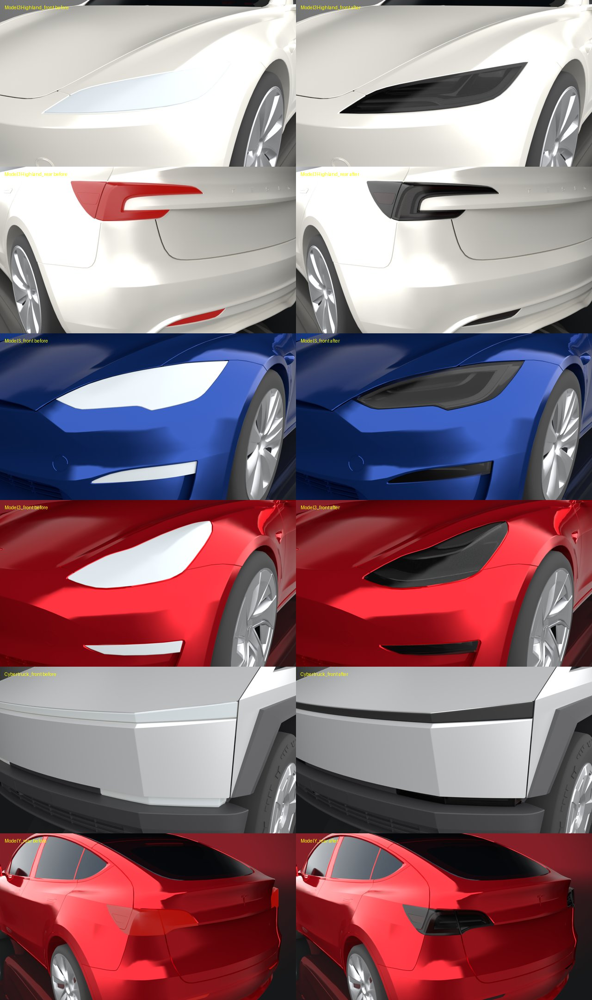
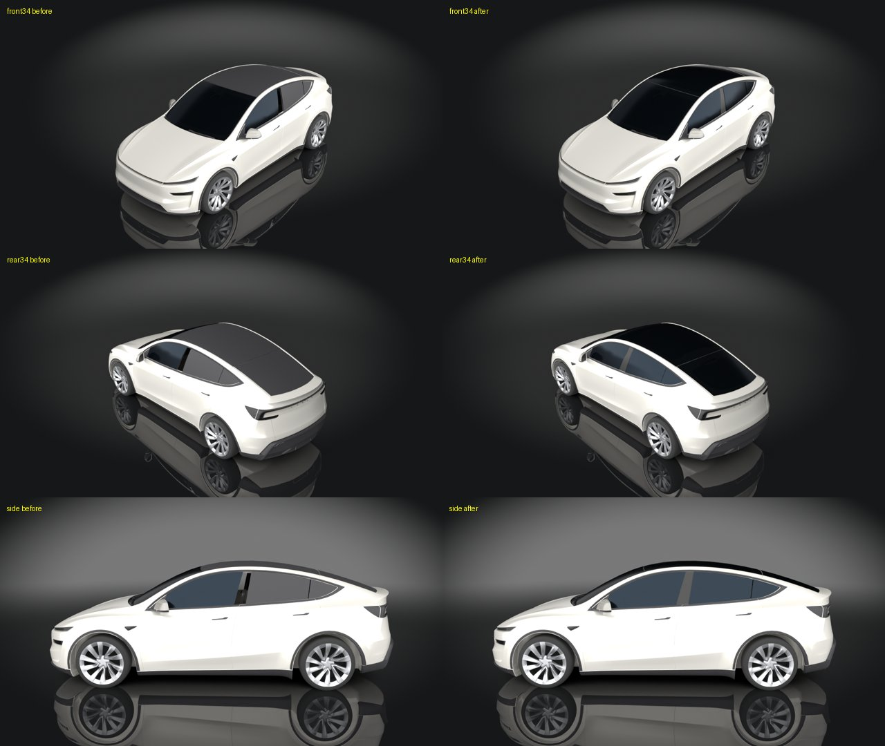

# Showroom stage

`Powerwall-TV/ShowroomStage.swift` rebuilds the stage the Tesla app puts a car on.
The values come from the Tesla Android app 4.62.5 asset pack, decompiled with GDRE Tools.

The before and after columns are Cycles approximations of the SceneKit scene, made with
`tools/render.py`. They are not simulator captures. The reference is
`assets/img/car_wrap_arcade_placeholder.png` from the app.

## What the Tesla app does

| Part | Tesla source | Value | SceneKit |
| --- | --- | --- | --- |
| Background | `EnvironmentManager.gd` `dark_background_color` | `#161718` | `scene.background`, view background |
| Lighting | `mobile.tscn`, `env/mobile.tres` | No lights. PanoramaSky `New_Studio.png` | `scene.lightingEnvironment` = `ShowroomStudio.png` |
| Sky rotation | `MobileEnvTest.gd`, `Snapshots.gd` PARKED | `(0, -11, 83)`° | Baked into `ShowroomStudio.png` by `tools/bake_env.py` |
| Sky energy | `Snapshots.gd` PARKED | background 6, ambient 2.6 | intensity 2.2, because our paint is lifted to display colours |
| Camera | `Snapshots.gd` PARKED | rotation `(-25, -138, 0)`°, `(-4.13, 3.09, -4.73)`, FOV 30° | `CarShowroomOrbit.restingOffset`, FOV 30° |
| Floor | `reflective_floor.tres`, `.shader` | unshaded, background colour, mirror at 10%, half resolution | `SCNFloor` reflectivity 0.1, `reflectionResolutionScaleFactor` 0.5 |
| Floor fade | `reflective_floor.shader` | `1 - smoothstep(5, 15, distance)` m | fragment shader modifier on alpha |
| Glow | `ReflectiveFloor.gd` `update_glow_plane` | 8.2 × 4.3 m half size, 16.3 m behind `(0, 1, 0)`, faces camera | `ShowroomStage.glowPlacement` |
| Glow colour | `Terrain.gd` `ColorToHighlightMap`, `calculate_highlight_for_paint_color` | paint table, else value × 0.325 × 5, max 0.7 | `ShowroomStage.highlight` |
| Glow opacity | `Terrain.tscn` `night_mode_highlight_fade` | 0.26, gone when looking down 37°–58° | material transparency |
| Contact shadow | each car's `Floor` quad and `Ground_AO*.png` | baked AO | `*_GroundAO.png` on a quad |

## Assets

- `ShowroomStudio.png`: `New_Studio.png` with the sky rotation baked in, 1024 × 512.
- `*_GroundAO.png`: each car's `Ground_AO` texture, rotated so the top is the nose (−Z) and the left is −X.
  Model Y Juniper uses Highland's, because its exported texture is empty. Generic uses Model 3's.

These are Tesla's copyrighted assets. Keep them in this private repository.

## Tuning

- `ShowroomStage.environmentIntensity` sets how bright the studio reflections are.
- If the studio reflections look mirrored left to right, flip `ShowroomStudio.png` horizontally.
  SceneKit's equirectangular convention was not checked on a device.

## Lamps

In the Tesla app the car is parked with its lamps off, so nothing glows. The lamps look right
because of the lamp housing material. Lights_BC is a texture atlas of chrome reflectors,
projector bowls, LED strips, and red and amber lenses. Lights_MRA packs metallic, roughness, and
occlusion. A thin smoked lens (Glass_Lights) sits over the housing. The mobile environment
(`env/mobile.tres`) has no glow or bloom. No vehicle scene contains an OmniLight or a SpotLight,
and there is no welcome animation.

| Car | Housing (`Light`/`Lights`) albedo × BC, metallic × R, roughness × G, AO = B | Lens (`Glass_Lights`) colour, alpha, roughness |
| --- | --- | --- |
| Model 3 | 0.102, 0.7, 0.0 (mirror) | 0.0118, 0.51, 0.05 |
| Model 3 Highland | 0.137, 1.0, 1.0 | 0.0118, 0.39, 0.05 |
| Model Y | 0.102, 0.7, 0.5 | 0.0118, 0.39, 0.05 |
| Model Y Juniper | `Light_Off` flat 0.0196, roughness 0.45 | 0.0118, 0.39, 0.05 |
| Model S | 0.098, 0.75, 0.5 | 0.0118, 0.43, 0.1 |
| Model X | 0.098, 1.0, 1.0 | 0.0118, 0.51, 0.1 |
| Cybertruck | `Lights1` 0.349, 0, 1.0 | 0, 0.51, 0.01 |

The glowing "lights on" meshes are separate. `Headlights`, `DRL`, `Brake_Lights_*`,
`Reverse_Light`, and the turn signals use `Illumination`, which is additive, unshaded black,
and shows the `Lights_E.png` emission map at energy 0.65–0.8. The `*_Projections` meshes add the
light pools on the ground. All of them are hidden by default. `Vehicle.gd` shows the headlights
only while the car is driving (`set_headlights_on(data.isDriving())`). The Godot glTF export
skips hidden nodes, so these meshes are not in our models.

`tools/build_vehicles_v2.py` now writes the lamp housing as `Lamps`, with `primvars:st`, and the
lens as `LampGlass`. It skips the `*_Global` lamp meshes, which use a different atlas. Before this
change both went into one flat red `Lights` mesh, which `VehicleLights` split into three glowing
lenses. `VehicleLamps` in `HouseLighting.swift` puts `<Model>_Lamps_BC.png` and
`<Model>_Lamps_MRA.png` on the housing, using `textureComponents` red, green, and blue, and makes
the lens the smoked glass.

`tools/headlights.py` makes the close-ups. Run it with `LAMPS=before|after`, `USDZ=`, and
`VIEW=front|rear`. The renders are Cycles approximations, not SceneKit captures.

## Floor reflection

The reflection used to come from `SCNFloor` (reflectivity 0.1, half resolution), with a Metal
fragment shader modifier fading the floor out. It did not show on an older macOS. Now the
reflection is the car again, flipped through the floor (`ShowroomStage.makeMirror`). The copy
shares the car's geometry and materials. A plain `SCNPlane` floor in the background colour covers
it at 90% (`reflection_strength` 0.1). The floor's alpha comes from a generated texture
(`floorImage`) and fades out between 5 m and 15 m, like `reflective_floor.shader`. Nothing depends
on SCNFloor reflections, reflection bit masks, or shader modifiers. The draw order is glow (−20),
mirror (−15), floor (−10), contact shadow (−5), then the car.

## Model Y Juniper glass and B pillars

Juniper's roof (`Fade`), rear glass (`Trunk_Cover`), and rear door and quarter windows
(`Back_*_window`, `Static_Exterior`) use `glass_skybox` ShaderMaterials (`Glass_Windows_Dark`,
`Glass_Top_Fade`). The glTF export writes no material for these, and the converter had mapped
them to opaque Trim. They now map to Glass, like the windscreen and front windows. No other car
has unnamed exterior surfaces. The B pillars sit on the `Interior` mesh, which is dropped: the
outer cover is on its Trim surface and the inner trim on its `Pillar` surface. The converter keeps
the triangles of those two surfaces between the door windows, as a gloss black `Pillar` material.
